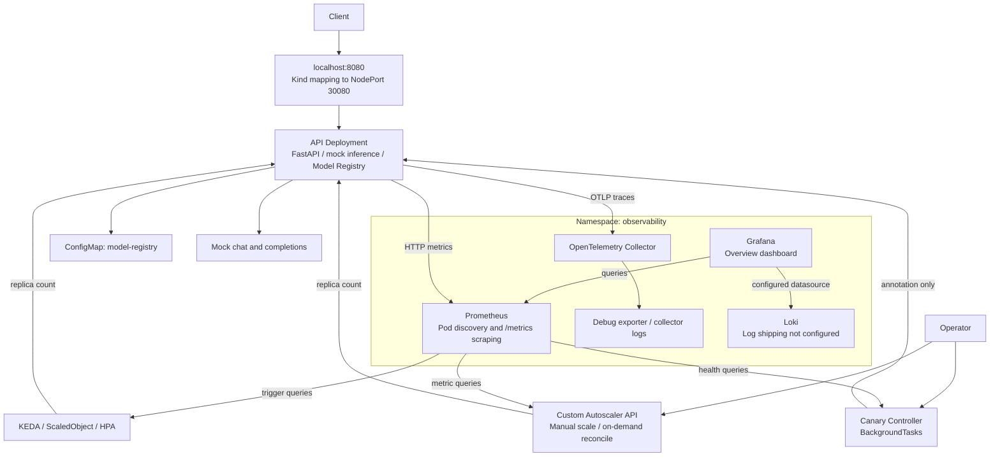
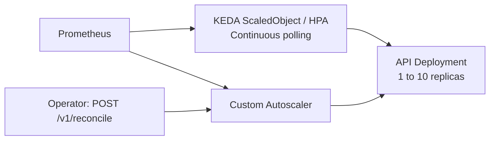
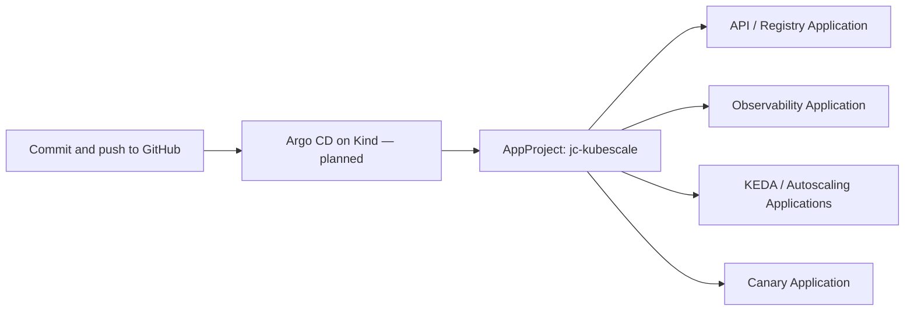

# JC-KubeScale AI

Kubernetes-native AI operations lab for inference APIs, observability, autoscaling, model metadata, and progressive rollout control.

[](https://github.com/jacivaldocarvalho/jc-kubescale-ai/actions/workflows/ci.yaml)
[](services/api/Dockerfile)
[](services/api/requirements.txt)
[](infrastructure/kind/kind-config.yaml)
[](docs/phase-4-model-registry.md)
[](LICENSE)

JC-KubeScale AI is a working prototype for exploring how an AI service is operated on Kubernetes. It combines a FastAPI API, Prometheus and Grafana, KEDA, a custom scaling API, a ConfigMap-backed Model Registry, and a Canary Controller.

**Current scope:** inference responses are mocked, LLM resource metrics are simulated, and canary percentages are stored as Deployment annotations. Real model execution, version-aware inference routing, and traffic splitting remain integration work.

## Project Status

| Phase | Implemented in this repository | Remaining scope |
|-------|--------------------------------|-----------------|
| **1 — API** | FastAPI chat/completions, health endpoints, Docker image, Kind deployment | Connect a real inference backend and implement streaming |
| **2 — Observability** | Prometheus scraping, provisioned Grafana overview, Loki deployment, OTel Collector | Configure log shipping and a persistent trace backend |
| **3 — Autoscaling** | KEDA Prometheus triggers and custom scaling/reconciliation endpoints | Real LLM metrics, continuous custom reconciliation, coordinated replica ownership |
| **4 — Registry and Canary** | ConfigMap persistence, version CRUD, RBAC, background rollout and annotation rollback | Shared registry consistency, version routing, traffic splitting, durable rollout state |
| **5 — Local GitOps** | Planned: Argo CD on Kind, AppProject and component Applications | Implementation and migration from manual deployment |
| **6 — Inference Validation** | Planned: CPU inference integration, engine metrics and k6 load tests | Backend selection, implementation and measured validation |

The source code and manifests define the current implementation. Previous local validation results are recorded below; they do not imply that every checkout or cluster has the same image or state.

## Problem

LLM services introduce operational challenges that an HTTP API alone does not solve:

- Model size and concurrency affect memory use, startup time, latency, and capacity.
- Request queues and KV cache pressure can reveal bottlenecks that CPU utilization misses.
- Operators need visibility into errors, latency, and resource pressure before changing capacity or releasing a model version.
- Multiple model versions require lifecycle tracking and consistent routing decisions.
- Progressive delivery needs measurable health checks and a reliable rollback mechanism.

This project provides a local environment for investigating these concerns before connecting an inference engine or deploying production workloads.

## Solution

The platform separates the inference API, model metadata, scaling decisions, and rollout control into inspectable components. Kubernetes manifests and Make targets support repeatable local experiments; Prometheus metrics and controller logs expose their behavior.

The API currently returns deterministic demonstration responses from [InferenceService](services/api/src/app/services/inference.py). Registering a model records its metadata; it does not download weights, load a model, or change which backend serves a request. Setting `INFERENCE_ENDPOINT` alone does not enable real inference because the mock service does not call that endpoint.

## Real-World Applications

These are practical applications of the platform's building blocks, rather than claims of existing production deployments.

| Application | What can be exercised today | What is needed for the complete scenario |
|-------------|-----------------------------|-----------------------------------------|
| **Platform engineering and SRE training** | Deploy services on Kind, diagnose RBAC failures, inspect metrics, and practice rollout/rollback procedures | Organization-specific scenarios and operational acceptance criteria |
| **Capacity experiments for an AI API** | Generate HTTP load, observe latency and simulated queue/cache signals, and inspect KEDA replica changes | Real inference, engine metrics, representative traffic, and hardware measurements before making cost or GPU sizing decisions |
| **Model release rehearsals** | Register candidate versions, update lifecycle status, and observe 10% → 50% → 100% annotation progression with health checks | A version-aware router or traffic-management layer, version-specific metrics, and model quality evaluation |
| **Internal knowledge assistants and support copilots** | Prototype the client/API contract and the surrounding monitoring and deployment workflow | A model backend, retrieval/document ingestion where required, access controls, and answer-quality evaluation |
| **Document classification, summarization, or extraction services** | Use the API and registry as a starting point for an operated text-processing service | Task-specific prompts or models, input/output validation, job handling for long tasks, and domain evaluation |
| **Incident response exercises** | Investigate missing permissions, unavailable metrics, pod replacements, and interrupted port-forwards | Automated failure injection, durable recovery, and measured SLOs for a production exercise |

A useful first exercise is to register a candidate model, run HTTP load against the mock API, observe Prometheus and KEDA, start a background rollout, follow the annotation and logs, and reset the percentage after completion. This tests the operational workflow without requiring model weights or a GPU.

## Current Architecture



KEDA and the custom autoscaler can both write the API replica count. The custom service does not run a periodic reconciliation loop: `POST /v1/reconcile` performs one reconciliation. Its cooldown timestamps belong to service instances created per request and do not provide a shared scheduling mechanism. Coordinate these control paths when experimenting with scaling.

## Quick Start

### Prerequisites

- Docker with a running daemon and permission to build images.
- Kind, kubectl, Helm, GNU Make, and Bash.
- Python 3.11+ for local development and the Makefile's JSON formatting commands.
- Available local ports: 6443 for the Kind API server, 8080 for the API, and 8081 for the Canary port-forward. Observability uses 3000, 9090, and 3100 when forwarded.

The supplied Kind configuration creates one control-plane node and three workers. The mock workload does not require a GPU. [scripts/setup.sh](scripts/setup.sh) provides tool installation helpers; its Linux downloads target amd64 and include pinned Kind/kubectl versions. Review the script for your environment before running it.

### First Deployment on a Local Kind Cluster

```bash
git clone https://github.com/jacivaldocarvalho/jc-kubescale-ai.git
cd jc-kubescale-ai
make check-deps

# Creates the configured cluster; deletes an existing cluster with this name.
make cluster
make install
make deploy

# Prometheus must be available for metric-driven scaling and rollout checks.
make deploy-observability
make deploy-autoscaling
make deploy-canary

curl --fail-with-body http://localhost:8080/health
curl --fail-with-body http://localhost:8080/v1/models
```

`make all` recreates the cluster and deploys/tests the API; it does not deploy observability, autoscaling, or Canary. `make deploy` rebuilds and reloads the API image and removes the previous API Deployment and Service before applying the manifests. Use the rollout procedure below when refreshing only the Canary image.

Base manifests use the `jc-kubescale` and `observability` namespaces. Changing the Makefile's namespace variable alone does not rewrite manifest namespaces. The API is accessible at `localhost:8080` through the supplied Kind NodePort mapping.

### Access Services

`make deploy-observability` starts its port-forwards. To start them again, use `make port-forward-all`; that target covers Grafana, Prometheus, and Loki only. For Canary, run this command in a separate terminal:

```bash
kubectl --context kind-jc-kubescale port-forward -n jc-kubescale svc/jc-kubescale-canary 8081:8080
```

| Service | Local URL | Access |
|---------|-----------|--------|
| API and Registry | http://localhost:8080 | Kind NodePort mapping |
| API OpenAPI UI | http://localhost:8080/docs | FastAPI interactive documentation |
| Canary Controller | http://localhost:8081 | Separate port-forward |
| Grafana | http://localhost:3000 | Observability port-forward; local defaults: `admin` / `admin` |
| Prometheus | http://localhost:9090 | Observability port-forward |
| Loki | http://localhost:3100 | Observability port-forward; query API |

A port-forward may end when its selected pod is replaced. Restart the corresponding process against the Service after the new pod is ready.

### Refresh the Canary Image

```bash
# load-canary includes build-canary; a separate build is unnecessary.
make load-canary
kubectl --context kind-jc-kubescale rollout restart deployment/jc-kubescale-canary -n jc-kubescale
kubectl --context kind-jc-kubescale rollout status deployment/jc-kubescale-canary -n jc-kubescale --timeout=120s
```

### Helm Scope

[charts/jc-kubescale](charts/jc-kubescale) supplies an alternative API deployment with ServiceAccount/RBAC, a Service, optional Ingress, and an optional CPU-based HPA. Its default Service is ClusterIP, so it does not provide the base manifests' NodePort access automatically. The chart does not deploy the custom Autoscaler or Canary services. [charts/jc-kubescale-observability](charts/jc-kubescale-observability) contains chart metadata and values, while the Makefile deploys observability from `deploy/observability/`.

## API and Model Registry

The API exposes `GET /health`, `GET /ready`, `GET /metrics`, and the endpoints below. `/ready` currently reports mock inference readiness; it does not validate Registry access or an external model server.

| Method | Endpoint | Purpose |
|--------|----------|---------|
| POST | `/v1/chat` | Return a mock chat response |
| POST | `/v1/completions` | Return a mock completion |
| GET | `/v1/models` | List registered model versions |
| GET | `/v1/models/{name}` | List versions of a model |
| GET | `/v1/models/{name}/versions/{version}` | Retrieve one version |
| POST | `/v1/models` | Register or replace a version |
| PATCH | `/v1/models/{name}/versions/{version}/status` | Update status |
| DELETE | `/v1/models/{name}/versions/{version}` | Remove a version |

### Inference Examples

```bash
curl --fail-with-body -X POST http://localhost:8080/v1/chat \
  -H 'Content-Type: application/json' \
  -d '{"message":"What is Kubernetes?","model":"qwen"}'

curl --fail-with-body -X POST http://localhost:8080/v1/completions \
  -H 'Content-Type: application/json' \
  -d '{"prompt":"Machine learning is","max_tokens":50}'
```

Responses include `model`, `response` or `text`, and `usage`. Current mock response strings are in Portuguese, and token counts use whitespace splitting. `temperature`, `max_tokens`, and the chat `stream` field do not enable real sampling, output limits, or streaming in the mock implementation. The `model` field does not select a registered backend version.

### Registry Examples

```bash
curl --fail-with-body http://localhost:8080/v1/models

curl --fail-with-body -X POST http://localhost:8080/v1/models \
  -H 'Content-Type: application/json' \
  -d '{"name":"qwen-demo","version":"1","status":"ready","size":"7B"}'

curl --fail-with-body -X PATCH http://localhost:8080/v1/models/qwen-demo/versions/1/status \
  -H 'Content-Type: application/json' -d '{"status":"deprecated"}'

curl --fail-with-body -X DELETE http://localhost:8080/v1/models/qwen-demo/versions/1
```

The Registry stores JSON in `models.json` inside the `model-registry` ConfigMap. It creates the ConfigMap on first Registry access if missing and seeds four demonstration versions: `qwen:1`, `qwen:2`, `qwen-small:1`, and `qwen-large:1`. A persisted empty registry remains empty. The metadata includes model name, version, status, path, size, timestamps, and additional metadata.

The base API Deployment uses ServiceAccount `jc-kubescale-api`; its Role and RoleBinding are applied before the Deployment. Registry routes run synchronous Kubernetes calls in FastAPI's thread pool. Writes are persisted before the new state is published to the local cache. Dependency/configuration failures return HTTP 503 with `code` and `detail`; write conflicts return HTTP 409.

Each API process caches its own registry. There is no cross-replica refresh or distributed write coordination, so concurrent writers can observe stale data or overwrite changes. Registry status is metadata, not a model health probe, and status values are currently free-form strings.

## Canary Controller

| Method | Endpoint | Purpose |
|--------|----------|---------|
| GET | `/v1/canary` | Read the current annotation percentage |
| POST | `/v1/canary/{percentage}` | Set a percentage from 0 to 100 |
| POST | `/v1/rollout` | Schedule the configured stages in the background |
| POST | `/v1/rollback` | Reset the annotation to 0% |

The controller also exposes `/health`, `/ready`, and `/metrics`.

```bash
curl --fail-with-body http://localhost:8081/v1/canary
curl --fail-with-body -X POST http://localhost:8081/v1/canary/25
curl --fail-with-body -X POST http://localhost:8081/v1/rollback
curl --fail-with-body -X POST http://localhost:8081/v1/rollout
```

Expected scheduling response:

```json
{"status":"started","message":"Rollout started in background","stages":[10,50,100]}
```

The supplied Deployment sets a 30-second interval, so a successful three-stage rollout takes at least 90 seconds plus query time. The service's configuration default, when not overridden, is 60 seconds per stage. Watch completion in the logs and inspect the annotation:

```bash
make logs-canary

# Run in another terminal.
kubectl --context kind-jc-kubescale get deployment jc-kubescale-api -n jc-kubescale \
  -o go-template='{{index .metadata.annotations "jc-kubescale/canary"}}{{"\n"}}'
```

Wait for `Rollout completed successfully` or a failure/rollback result before issuing another rollout or the final rollback. The controller has no rollout ID, persistent status API, concurrency guard, or cancellation mechanism. Background tasks do not resume after process restarts.

Health checks compare aggregate HTTP error rate and p95 latency against defaults of 5% and 2 seconds. If a check fails, the controller attempts to reset the annotation to zero. Missing/query-failed metrics currently fall back to zero, and the queries do not isolate a model version. Manual responses include a `success` field that should be checked; HTTP 200 alone does not establish that a Kubernetes update succeeded.

**Traffic behavior:** the controller changes `jc-kubescale/canary` on the API Deployment. It does not distribute requests, deploy a candidate model, or restore an image/ReplicaSet during rollback. Those behaviors require a router and deployment integration.

## Observability

| Component | Current behavior |
|-----------|------------------|
| Prometheus | Discovers annotated pods in `jc-kubescale` and scrapes their metrics every 15 seconds |
| Grafana | Provisions Prometheus/Loki/Tempo datasource definitions and the **JC-KubeScale AI - Overview** dashboard |
| Loki | Provides a log storage/query service; no application log shipper is deployed |
| OpenTelemetry Collector | Accepts OTLP and sends telemetry to its debug exporter; no persistent trace backend is deployed |

The Tempo datasource definition does not create a Tempo service. JSON logs are available through `kubectl logs`; they are not automatically shipped to Loki. Prometheus storage uses `emptyDir`; Grafana uses a PVC. Other dashboard JSON files are present under `observability/grafana/dashboards/`, but the base deployment provisions the overview embedded in its ConfigMap.

| Metric | Meaning in the current API |
|--------|----------------------------|
| `http_requests_total` | HTTP request counter labeled by method, endpoint, and status |
| `http_request_latency_seconds` | Observed HTTP latency histogram |
| `http_active_requests` | Active HTTP requests |
| `queue_depth` | Simulated queue based on in-flight HTTP requests |
| `kv_cache_utilization` | Simulated value increased after requests; not actual GPU cache use |
| `tokens_per_second` | Simulated value derived from HTTP latency |
| `tokens_input_total`, `tokens_output_total`, `model_load_time_seconds` | Declared metrics without updates from the current inference path |

Autoscaler and Canary event/status metrics are also declared but not wired to their operations. Interpret dashboards and scaling experiments with these instrumentation limits in mind.

## Autoscaling

Two separate control paths are available: KEDA continuously polls Prometheus through its ScaledObject/HPA, and the custom Autoscaler applies one decision when requested through its API. The custom service patches the Deployment directly; it does not forward its decision to KEDA.



The supplied ScaledObject uses these Prometheus trigger thresholds:

| Signal | Query | Threshold |
|--------|-------|-----------|
| Queue depth | `sum(queue_depth)` | 5 |
| KV cache utilization | `avg(kv_cache_utilization)` | 80% |
| p95 latency | `max(histogram_quantile(0.95, sum(rate(http_request_latency_seconds_bucket[5m])) by (le)))` | 2 seconds |

KEDA polls every 15 seconds, with a replica range of 1–10 and HPA scaling policies defined in [scaledobject.yaml](deploy/autoscaling/scaledobject.yaml). The custom service scales up by one when any configured high threshold is exceeded, or down by one when all low conditions hold: queue depth ≤ 1, KV cache < 30%, and p95 latency < 0.5 seconds. Its metrics queries differ from KEDA's; their decisions are not guaranteed to match.

The custom Autoscaler exposes `/health`, `/ready`, `/metrics`, and:

| Method | Endpoint | Purpose |
|--------|----------|---------|
| GET | `/v1/metrics` | Query current scaling signals |
| GET | `/v1/replicas` | Read the target Deployment's replica count |
| POST | `/v1/reconcile` | Perform one reconciliation |
| POST | `/v1/scale?replicas=N` | Request manual scaling, bounded by service settings |

For local access, forward its Service on a separate port:

```bash
kubectl --context kind-jc-kubescale port-forward -n jc-kubescale svc/jc-kubescale-autoscaler 8082:8080
```

## Configuration

Each service uses environment-backed settings. The following defaults and manifest overrides are relevant to the local setup:

| Service | Settings | Behavior |
|---------|----------|----------|
| API | `MODEL_REGISTRY_CONFIGMAP`, `MODEL_REGISTRY_NAMESPACE` | Default ConfigMap `model-registry`; base/Helm Deployments inject the pod namespace |
| API | `MODEL_NAME`, `MODEL_VERSION`, `INFERENCE_ENDPOINT` | Mock metadata/configuration; no remote inference call yet |
| API | `OTLP_ENDPOINT` | Enables API tracing when nonempty |
| Autoscaler | `TARGET_NAMESPACE`, `TARGET_DEPLOYMENT`, `MIN_REPLICAS`, `MAX_REPLICAS` | Defaults target `jc-kubescale/jc-kubescale-api`, bounded to 1–10 replicas |
| Canary | `CANARY_STAGES`, `CANARY_INTERVAL` | Stages `10,50,100`; 60-second settings default, overridden to 30 seconds by the base manifest |
| Canary | `CANARY_ERROR_THRESHOLD`, `CANARY_LATENCY_THRESHOLD` | Defaults: `0.05` and `2.0` |
| Controllers | `PROMETHEUS_URL` | Defaults to `http://prometheus-server.observability.svc.cluster.local:80` |

Docker builds install each service's `requirements.txt`. The API's `pyproject.toml` dependency versions differ from that file; it is not an equivalent installation specification. When changing the Registry ConfigMap name in Helm, update the Role's `resourceNames` permission as well.

## Make Commands

| Command | Scope |
|---------|-------|
| `make check-deps` | Check local tools |
| `make cluster` / `make cluster-delete` | Recreate / delete the named Kind cluster |
| `make install` | Create the application namespace and configure Helm repositories |
| `make build` / `make load-image` / `make deploy` | Build / build and load / replace the API deployment |
| `make deploy-observability` | Apply observability manifests and start its port-forwards |
| `make deploy-autoscaling` | Install KEDA and deploy the custom Autoscaler and ScaledObject |
| `make build-canary` / `make load-canary` / `make deploy-canary` | Build / build and load / build, load, and apply Canary manifests |
| `make status` / `make status-observability` / `make status-autoscaling` / `make status-canary` | Inspect each component |
| `make logs` / `make logs-observability` / `make logs-autoscaler` / `make logs-canary` | Inspect component logs |
| `make port-forward-all` / `make port-forward-stop` | Start / stop observability port-forwards |
| `make test-api` | Run HTTP smoke commands; inspect output because errors can be masked |
| `make backup-grafana` | Copy the Grafana SQLite database to `backups/` |
| `make undeploy-canary` / `make undeploy-autoscaling` | Remove the selected controller resources |
| `make undeploy-observability` | Remove observability workloads/configuration while preserving PVCs |
| `make undeploy-observability-clean` | Delete the observability namespace and its data |
| `make undeploy` | Delete the application namespace, including Registry data and controller resources |
| `make clean` | Delete the local cluster and remove the API image |

Several legacy Make targets suppress command errors. Check Kubernetes rollout status and endpoint responses directly when verifying a change. `deploy-canary` applies the image tag `latest`; use the explicit restart procedure above to activate a rebuilt image on an existing Deployment.

## Validation and CI

The local Phase 4 validation on October 17, 2026 recorded:

- Registry list, registration, and status update returning HTTP 200, with persistence confirmed in the ConfigMap.
- Two API replicas ready with ServiceAccount `jc-kubescale-api` after correcting the live pod template.
- The rebuilt Canary responding to `POST /v1/rollout` in approximately **19 ms** with the configured stages.
- Annotation progression **10% → 50% → 100%**, completed in **90 seconds**, with `/health` available and no Canary pod restarts.
- Manual rollback confirmed at **0%** in the controller API and Deployment annotation.

These observations validate the mock API and annotation workflow. Automatic rollback under injected failure, real traffic splitting, model quality, and production capacity were not established by those checks. See the [Phase 4 guide](docs/phase-4-model-registry.md) for details.

[GitHub Actions](.github/workflows/ci.yaml) defines formatting/lint checks, API tests, Trivy scans, Helm linting, manifest validation, and API image publication to GHCR on configured pushes. It does not deploy the platform, build all three services, or validate a full rollout. Its flake8 and pytest commands currently tolerate failures with `|| true`, so CI completion is not proof of test success.

The API test files under `services/api/src/tests/`, which `make test` and CI target, are currently empty. Basic tests exist under `tests/`; they need explicit import-path setup, dependencies, and Kubernetes access for Registry calls. Expanding and aligning the test suite is outstanding work.

## Project Structure

```text
jc-kubescale-ai/
├── Makefile                         # Local build/deployment operations
├── services/
│   ├── api/                         # Mock inference API and Model Registry
│   ├── autoscaler/                  # Scaling metrics and on-demand reconciliation
│   └── canary/                      # Background progressive rollout controller
├── deploy/
│   ├── base/                        # Namespace, API Deployment/Service, and RBAC
│   ├── observability/               # Prometheus, Grafana, Loki, OTel manifests
│   ├── autoscaling/                 # KEDA and custom Autoscaler manifests
│   ├── canary/                      # Canary Deployment/Service and RBAC
│   └── models/                      # Example Qwen model metadata ConfigMaps
├── charts/
│   ├── jc-kubescale/                # API Helm chart
│   └── jc-kubescale-observability/   # Observability chart metadata and values
├── observability/                   # Additional configuration and dashboard files
├── infrastructure/kind/             # Four-node local cluster and port mappings
├── scripts/                         # Setup helpers
├── docs/                            # Phase guides
├── tests/                           # Basic API tests
└── .github/workflows/ci.yaml         # CI checks and API image publication
```

The example ConfigMaps in `deploy/models/` are not automatically imported by the Registry. Base deployment commands use files in `deploy/`; additional configuration files under `observability/` are not automatically applied by those commands.

## Documentation

| Document | Scope |
|----------|-------|
| [Phase 1 — API](docs/phase-1-api.md) | Initial API architecture and development workflow |
| [Phase 2 — Observability](docs/phase-2-observability.md) | Observability components and operations |
| [Phase 3 — Autoscaling](docs/phase-3-autoscaling.md) | Scaling signals, services, and KEDA |
| [Phase 4 — Model Registry and Canary](docs/phase-4-model-registry.md) | Persistence, RBAC, background rollout, limitations, and validation |

Phase guides describe their implementation stages. Use the current source and this README's scope notes when a historical example differs from the current behavior.

## Security and Operational Boundaries

ServiceAccounts and RBAC are implemented for the API, controllers, and Prometheus discovery. API authentication, authorization, and rate limiting are not enforced by the current routes, even though related settings exist. CORS is permissive, Grafana uses local demonstration credentials, and the base setup does not configure TLS, NetworkPolicies, or managed secrets. These are integration requirements before exposing the services beyond a controlled development environment.

ConfigMap persistence survives API pod replacement while the namespace exists; deleting the cluster or application namespace removes that data. It is a lightweight metadata store, not a model artifact repository or a distributed transactional registry.

## Next Phases

Phases 5 and 6 are agreed next steps, documented here as plans. No Argo CD
installation, GitOps Applications, real inference deployment, or new Make targets
are delivered by Phase 4. Terraform/cloud environments remain later work.

### Phase 5 — Local GitOps with Argo CD

**Objective:** install Argo CD in the existing Kind cluster and make the GitHub
repository the source of desired deployment configuration, replacing routine
manual `kubectl apply` with Git-based synchronization.

Planned deliverables:

1. Install a pinned, reviewed Argo CD release in namespace `argocd` and document
   bootstrap, access, upgrades, and removal.
2. Define a `jc-kubescale` AppProject with explicit repository, namespace, and
   resource permissions, including required cluster-scoped RBAC and KEDA CRDs.
3. Add Applications for API/Registry, observability, autoscaling, and Canary.
   Manage KEDA installation explicitly, separately from workloads that require
   its CRDs. Choose individual Applications or an App of Apps bootstrap.
4. Track `https://github.com/jacivaldocarvalho/jc-kubescale-ai.git`, with
   `develop` as the proposed revision, after the required manifests have been
   committed and pushed to that branch. Public repository access should require
   no credentials; private access would require an Argo CD repository Secret.
5. Add `install-argocd`, `deploy-gitops`, and `port-forward-argocd` Make targets.
   Reserve **https://localhost:8083** for the UI; port 8082 is already used in
   this README for the custom Autoscaler. Retrieve initial credentials explicitly
   rather than printing them during every installation.
6. Validate synchronization, controlled drift correction, pruning behavior, and
   a Git revert recovery workflow before enabling automated `selfHeal` and
   `prune` for adopted workloads. Use `CreateNamespace=true` where namespace
   creation is assigned to the Application.

Proposed additions, **not existing files**:

```text
gitops/
├── argocd/
│   ├── install.yaml          # Optional pinned installation/bootstrap source
│   ├── project.yaml          # AppProject
│   └── applications/
│       ├── api.yaml
│       ├── observability.yaml
│       ├── autoscaling.yaml
│       └── canary.yaml
└── bootstrap/
    └── root-app.yaml         # Optional App of Apps
```



Migration decisions to resolve during implementation:

- Define dependency ordering and readiness checks for namespaces, RBAC,
  Prometheus, KEDA CRDs/controllers, and their workloads. Application creation
  order alone must not be treated as proof that dependencies are ready.
- Give each resource one owner. The current `keda-install.yaml` contains only
  Helm command comments, so syncing that directory alone will not install KEDA.
  The directory also contains a standalone Service already included in the
  autoscaler Deployment file. Filter or reorganize these sources before
  assigning Applications to avoid duplicate resource ownership.
- Let HPA/controller changes to `/spec/replicas` coexist with GitOps, and account
  for the runtime `jc-kubescale/canary` annotation. Use narrowly scoped diff
  exclusions and ensure synchronization respects them. Argo CD documents this
  distinction in [Sync Options](https://argo-cd.readthedocs.io/en/stable/user-guide/sync-options/).
- Keep the API-created `model-registry` ConfigMap and its mutable contents out
  of declarative seed ownership. Define namespace/PVC deletion policies before
  enabling automatic pruning, and avoid overlapping Namespace ownership.
- GitOps does not build or load images. The existing `latest`/`IfNotPresent`
  workflow needs an explicit Kind image-loading strategy and immutable image
  references or rollout triggers so that Git changes actually activate new code.
- Move away from destructive legacy `deploy-clean` operations after adoption;
  retain only the manual bootstrap and documented recovery operations needed.

Acceptance requires the published Git revision to synchronize all intended
Applications, preserve autoscaling and mutable Registry data, activate the
expected image, and demonstrate recovery without routinely applying workload
manifests manually. Follow Argo CD's [AppProject documentation](https://argo-cd.readthedocs.io/en/stable/user-guide/projects/)
and [sync phases and waves](https://argo-cd.readthedocs.io/en/stable/user-guide/sync-waves/)
when implementing the resource boundaries and ordering.

### Phase 6 — Validation with an Inference Workload

**Objective:** connect the API to an inference backend on Kind, replace simulated
measurements with engine/request telemetry, and evaluate scaling with repeatable
traffic. This follows the GitOps delivery work in Phase 5.

Backend candidates remain subject to a CPU architecture, memory, image, model
license, and functional compatibility check on the actual host:

| Candidate | Proposed role | Decision still required |
|-----------|---------------|-------------------------|
| Ollama | CPU backend for a small local model | Image/model choice, storage, API adapter, and available resources |
| vLLM CPU | Alternative serving backend; a small model such as `Qwen2.5-0.5B-Instruct` is a candidate | Supported CPU build/model combination and host capacity |
| Improved simulator | Fallback for variable latency, queues, and repeatable scaling exercises | Clearly label results as simulated; this does not satisfy real inference acceptance |

Planned deliverables and validation:

1. Deploy the selected backend and model storage through GitOps with explicit
   resource requests, limits, startup/readiness behavior, and download handling.
2. Implement the API adapter with request timeouts, error handling, response/usage
   mapping, and an explicit development mock mode. Changing `INFERENCE_ENDPOINT`
   alone is insufficient in the current implementation.
3. Record actual end-to-end inference latency, backend token usage/throughput,
   errors, and measured queue/resource signals where the engine exposes them.
   Stop labeling simulated values as real KV cache or engine telemetry.
4. Add k6 scripts with representative prompts, warm-up and steady-state runs,
   repeatable concurrency, success criteria, and saved results. Observe KEDA's
   decisions alongside request latency and backend capacity; adding API replicas
   does not add capacity to a single shared CPU model server by itself.
5. Document model/backend configuration, host characteristics, functional tests,
   performance limits, and how to reproduce measurements without promising a
   throughput target before benchmarking.

Acceptance requires requests to reach a real model backend, usable answers and
usage data, backend-aware readiness/error handling, measured inference metrics,
and a reproducible load/scaling report. A simulator-only run must be reported as
a fallback experiment. Actual canary traffic validation additionally requires
the version-aware routing that is still absent after Phase 4.

## Longer-Term Roadmap

- Connect KServe/vLLM or another inference backend and replace simulated metrics with engine telemetry.
- Add version-aware routing and actual weighted traffic distribution with per-version health checks.
- Coordinate Registry writes/caches across replicas and add model artifact storage.
- Add durable rollout state, concurrency/cancellation controls, and failure-injection tests; reject unavailable health data rather than treating it as healthy.
- Define ownership between KEDA and custom scaling, with persistent cooldown/reconciliation behavior.
- Ship application logs to Loki and configure a trace backend with retention.
- Implement authentication, authorization, rate limits, transport security, and environment-specific secrets.
- Align dependencies and tests; make CI checks enforce failures and cover all services.
- Complete the planned Phase 5 GitOps and Phase 6 inference validation before moving to Terraform/cloud environments, chaos experiments, and measured SLOs/SLIs.

## Contributing

1. Fork the project.
2. Create a branch for your feature (`git checkout -b feature/new-feature`).
3. Commit your changes (`git commit -m 'Add new feature'`).
4. Push to the branch (`git push origin feature/new-feature`).
5. Open a Pull Request describing the change and its validation.

## License

Distributed under the MIT License. See [LICENSE](LICENSE).

## Author

**Jacivaldo Carvalho**

Telecommunications Engineer | DevOps | SRE | Networking

## Acknowledgments

Kubernetes, FastAPI, Kind, Helm, Prometheus, Grafana, Loki, OpenTelemetry, and KEDA communities.
