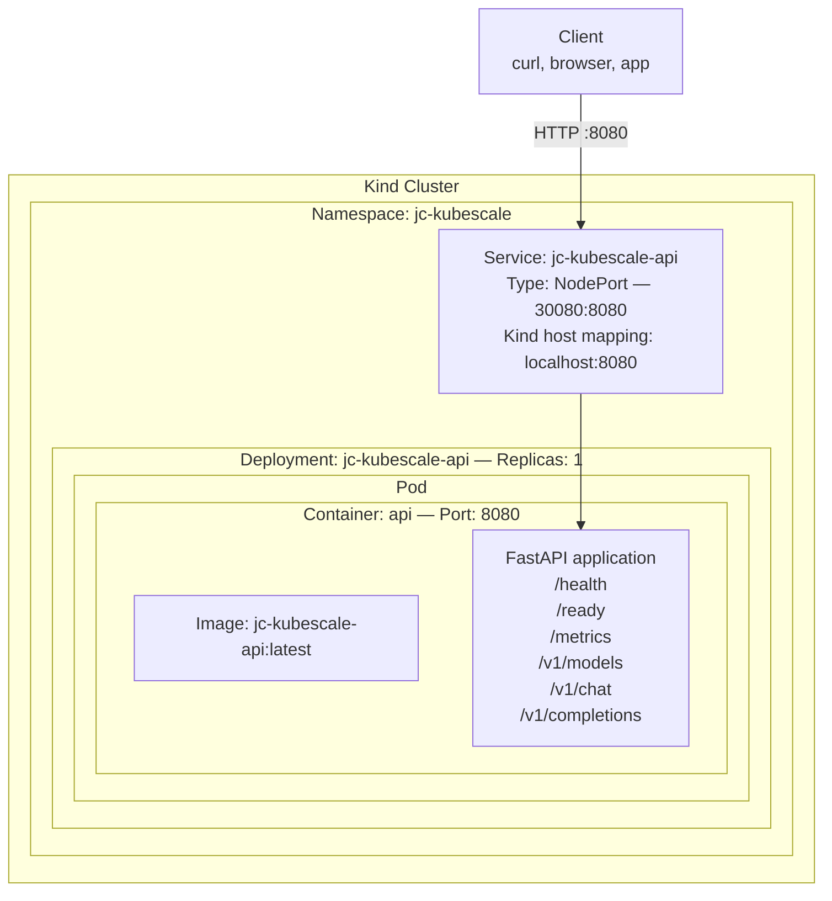
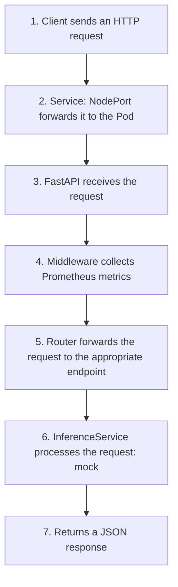

# JC-KubeScale AI - PHASE 1: API

## Overview

PHASE 1 establishes the foundation of the JC-KubeScale AI platform by implementing a RESTful API with FastAPI running inside Kubernetes. The API provides endpoints for LLM inference through an abstraction layer.

The current inference implementation is a mock. Since Phase 4, `/v1/models`
is served by the ConfigMap-backed Registry described in the
[Phase 4 guide](phase-4-model-registry.md); it requires Kubernetes credentials
and RBAC even when the API runs locally. See the [README](../README.md) for
the current scope and the planned Phases 5 and 6.

## Current Architecture



## API Directory Structure

```text
services/api/
├── Dockerfile               # Container image
├── requirements.txt         # Python dependencies
├── src/
│   ├── main.py              # FastAPI entry point
│   ├── app/
│   │   ├── __init__.py
│   │   ├── api/
│   │   │   ├── __init__.py
│   │   │   ├── routes.py       # API endpoints
│   │   │   ├── models.py       # Pydantic schemas
│   │   │   ├── model_registry.py # Model Registry routes (Phase 4)
│   │   │   └── dependencies.py # Dependency injection
│   │   ├── core/
│   │   │   ├── __init__.py
│   │   │   ├── config.py       # Configuration
│   │   │   ├── logging.py      # Structured logging
│   │   │   └── exceptions.py   # Custom exceptions
│   │   ├── models/
│   │   │   ├── __init__.py
│   │   │   ├── schemas.py      # Response schemas
│   │   │   └── registry.py     # Registry metadata schemas (Phase 4)
│   │   └── services/
│   │       ├── __init__.py
│   │       ├── inference.py    # Inference logic (mock)
│   │       └── model_registry.py # ConfigMap persistence (Phase 4)
│   └── tests/
│       ├── test_health.py
│       └── test_chat.py
└── Dockerfile.dev           # Development mode
```

## Request Flow



## Commands for Execution and Testing

### Initial Setup

```bash
# 1. Clone the repository
git clone https://github.com/jacivaldocarvalho/jc-kubescale-ai.git

cd jc-kubescale-ai

# 2. Install tools (Linux)
chmod +x scripts/setup.sh
./scripts/setup.sh

# 3. Check installed tools
make check-deps
```

### Deploy to Kubernetes

```bash
# 1. Create the Kind cluster (replaces an existing cluster with the same name)
make cluster

# 2. Install dependencies
make install

# 3. Build and deploy
make deploy

# 4. Check status
make status
```

### Tests

The legacy `make test` target and CI select the empty test modules under
`services/api/src/tests/`. Basic tests also exist in the root `tests/`
directory, but require explicit import-path/dependency setup and Kubernetes
access for Registry calls. Inspect actual test discovery/output rather than
treating a successful wrapper command as test coverage.

```bash
# 1. Legacy test target: currently selects empty files; not proof of coverage
make test

# 2. API smoke commands (Kind NodePort mapping; no port-forward required)
make test-api

# 3. Manual tests
curl http://localhost:8080/health

curl http://localhost:8080/v1/models

curl -X POST http://localhost:8080/v1/chat \
  -H "Content-Type: application/json" \
  -d '{"message":"Test"}'
```

### Logs and Debugging

```bash
# 1. View API logs
make logs

# 2. View detailed logs
kubectl logs -n jc-kubescale -l app=jc-kubescale-api --tail=100

# 3. Describe the pod for troubleshooting
kubectl describe pod -n jc-kubescale -l app=jc-kubescale-api

# 4. Access the container shell
kubectl exec -it -n jc-kubescale deployment/jc-kubescale-api -- /bin/bash
```

### Cleanup

```bash
# 1. Delete the application namespace, including persisted Registry metadata
make undeploy

# 2. Remove the cluster
make cluster-delete

# 3. Full cleanup
make clean
```

## Common Troubleshooting

### Error: `kind: command not found`

Check the installation helpers in `scripts/setup.sh` and choose a Kind binary
for your operating system and architecture. The Linux helper uses an amd64
download. Run `make check-deps` again after installing the required tools.

### Error: Pod in CrashLoopBackOff

```bash
# 1. View logs
kubectl logs -n jc-kubescale -l app=jc-kubescale-api

# 2. Check whether the image exists
docker images | grep jc-kubescale-api

# 3. Rebuild and reload (load-image already depends on build)
make load-image

kubectl rollout restart deployment jc-kubescale-api -n jc-kubescale
```

### Error: API Access Does Not Work

The base Kind setup maps NodePort 30080 to host port 8080. A port-forward is
an alternative when using a ClusterIP Service, such as the default Helm setup.
Use port 8084 to avoid the API (8080), Canary (8081), and Autoscaler (8082).

```bash
# 1. Check whether the pod is running
kubectl get pods -n jc-kubescale

# 2. Open a port-forward in this terminal
kubectl --context kind-jc-kubescale port-forward -n jc-kubescale svc/jc-kubescale-api 8084:8080

# 3. Test from another terminal
curl --fail-with-body http://localhost:8084/health
```

### Error: `ModuleNotFoundError: No module named 'app'`

```bash
# Check the __init__.py structure
cd services/api/src

find . -name "*.py" | sort

# It should include:
# ./app/__init__.py
# ./app/api/__init__.py
# ./app/core/__init__.py
# ./app/models/__init__.py
# ./app/services/__init__.py
# ./__init__.py
```

## Available Metrics (Prometheus)

| Metric                         | Type      | Description                   |
| ------------------------------ | --------- | ----------------------------- |
| `http_requests_total`          | Counter   | Total number of HTTP requests |
| `http_request_latency_seconds` | Histogram | Request latency               |
| `http_active_requests`         | Gauge     | Active requests               |

Endpoint: `GET /metrics`

## API Endpoints

| Method | Endpoint          | Description            |
| ------ | ----------------- | ---------------------- |
| GET    | `/health`         | Health check           |
| GET    | `/ready`          | Readiness probe        |
| GET    | `/metrics`        | Prometheus metrics     |
| GET    | `/v1/models`      | Lists registered model metadata; requires Kubernetes access |
| POST   | `/v1/chat`        | Mock chat response     |
| POST   | `/v1/completions` | Mock completion        |

### Example: `POST /v1/chat`

**Request:**

```json
{
  "message": "What is Kubernetes?",
  "model": "qwen",
  "temperature": 0.7,
  "max_tokens": 512
}
```

**Illustrative response shape** (the mock currently returns Portuguese text;
token counts use whitespace splitting):

```json
{
  "model": "qwen",
  "response": "Kubernetes is a platform...",
  "usage": {
    "input_tokens": 5,
    "output_tokens": 24,
    "total_tokens": 29
  }
}
```

## Validation Checklist

* [ ] `make cluster` creates the Kind cluster
* [ ] `make install` creates the namespace and configures Helm repositories
* [ ] `make build` builds the Docker image
* [ ] `make load-image` loads the image into Kind
* [ ] `make deploy` deploys the API
* [ ] `make status` displays the resources
* [ ] `make test-api` tests the endpoints
* [ ] `curl http://localhost:8080/health` returns HTTP 200
* [ ] `curl http://localhost:8080/v1/models` lists the available models
* [ ] `curl -X POST http://localhost:8080/v1/chat` returns a response
* [ ] `make undeploy` removes the resources
* [ ] `make cluster-delete` removes the cluster

## Next Steps (PHASE 2)

The observability components are documented in [Phase 2](phase-2-observability.md).
For upcoming work, see the [Phase 5 GitOps and Phase 6 inference plans](../README.md#next-phases).
