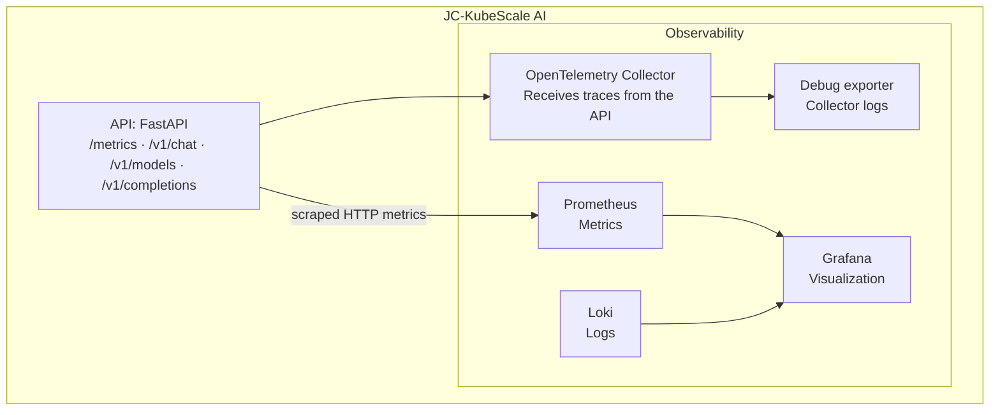

# PHASE 2 - Observability

## Overview

PHASE 2 provides the local observability components for the platform. Prometheus
scrapes application metrics and Grafana provisions an overview dashboard.
Loki is deployed without a log shipper, and the OTel Collector exports received
telemetry to debug logs. Centralized application logs and persistent trace
storage still require integration; a configured Tempo datasource does not
deploy Tempo. The [README](../README.md) describes the current project scope.

## Architecture



## Components

| Component          | Function                       | Port      | Access URL            |
| ------------------ | ------------------------------ | --------- | --------------------- |
| **Prometheus**     | Collects and stores metrics    | 9090      | http://localhost:9090 |
| **Grafana**        | Metrics and logs visualization | 3000      | http://localhost:3000 |
| **Loki**           | Log aggregation                | 3100      | http://localhost:3100 |
| **OTel Collector** | Receives traces and metrics    | 4317/4318 | -                     |

## Directory Structure

```
deploy/observability/
├── namespace.yaml
├── prometheus-configmap.yaml
├── prometheus-rules-configmap.yaml
├── prometheus-rbac.yaml
├── prometheus-deployment.yaml
├── grafana-configmap.yaml
├── grafana-pvc.yaml
├── grafana-deployment.yaml
├── loki-configmap.yaml
├── loki-deployment.yaml
├── otel-configmap.yaml
└── otel-collector.yaml
```

## 1. Prometheus

### 1.1. Configuration

Prometheus is configured via a ConfigMap containing a `prometheus.yml` file that defines the scrape jobs:

```yaml
scrape_configs:
  - job_name: 'jc-kubescale-api'
    kubernetes_sd_configs:
      - role: pod
        namespaces:
          names:
            - jc-kubescale
    relabel_configs:
      - source_labels: [__meta_kubernetes_pod_annotation_prometheus_io_scrape]
        action: keep
        regex: true
      - source_labels: [__meta_kubernetes_pod_annotation_prometheus_io_path]
        action: replace
        target_label: __metrics_path__
        regex: (.+)
      - source_labels: [__address__, __meta_kubernetes_pod_annotation_prometheus_io_port]
        action: replace
        regex: ([^:]+)(?::\d+)?;(\d+)
        replacement: $1:$2
        target_label: __address__
```

### 1.2. RBAC

Prometheus requires permissions to discover pods in the cluster. This is configured through:

* **ServiceAccount:** `prometheus`
* **ClusterRole:** `prometheus` (`get`, `list`, and `watch` permissions for pods, services, endpoints, and nodes)
* **ClusterRoleBinding:** `prometheus`

### 1.3. Pod Annotations

For Prometheus to discover a pod, the pod must include the following annotations:

```yaml
annotations:
  prometheus.io/scrape: "true"
  prometheus.io/port: "8080"
  prometheus.io/path: "/metrics"
```

### 1.4. Collected Metrics

| Metric                         | Type      | Description                   |
| ------------------------------ | --------- | ----------------------------- |
| `http_requests_total`          | Counter   | Total number of HTTP requests |
| `http_request_latency_seconds` | Histogram | Request latency               |
| `http_active_requests`         | Gauge     | Active requests               |
| `tokens_input_total`           | Counter   | Declared; not updated by the current mock inference path |
| `tokens_output_total`          | Counter   | Declared; not updated by the current mock inference path |

The API also publishes simulated `queue_depth`, `kv_cache_utilization`, and
`tokens_per_second` signals. These are useful for local experiments but do
not measure a real model engine. Prometheus stores its data in `emptyDir`;
pod replacement can lose the history.

### 1.5. Alerts

Configured alerting rules:

| Alert           | Condition                           | Severity |
| --------------- | ----------------------------------- | -------- |
| `APIDown`       | `up{job="jc-kubescale-api"} == 0`   | critical |
| `HighLatency`   | `histogram_quantile(0.95, ...) > 2` | warning  |
| `HighErrorRate` | `rate(...) > 0.05`                  | critical |

## 2. Grafana

### 2.1. Configuration

Grafana is configured through ConfigMaps:

* **Data sources:** Prometheus, Loki, Tempo
* **Dashboards:** Automatically provisioned dashboards

Only the overview embedded in `deploy/observability/grafana-configmap.yaml`
is provisioned by the base deployment. Other dashboard JSON files require
explicit provisioning. Tempo is a datasource definition only; no Tempo
Deployment is supplied.

### 2.2. Persistence

Grafana uses a PVC to persist:

* `grafana.db` (SQLite database)
* User configurations
* API keys
* Preferences

### 2.3. Data Sources

| Name       | Type       | URL                                                         |
| ---------- | ---------- | ----------------------------------------------------------- |
| Prometheus | prometheus | http://prometheus-server.observability.svc.cluster.local:80 |
| Loki       | loki       | http://loki.observability.svc.cluster.local:3100            |
| Tempo      | tempo      | http://tempo.observability.svc.cluster.local:3100           |

### 2.4. Dashboards

Provisioned dashboards:

* **JC-KubeScale AI - Overview:** Requests/s, P95 Latency, Active Requests, Error Rate, Tokens/s, Pod Status

## 3. Loki

### 3.1. Configuration

Loki is configured via a ConfigMap using schema v13 and TSDB:

```yaml
schema_config:
  configs:
    - from: 2020-10-24
      store: tsdb
      object_store: filesystem
      schema: v13
      index:
        prefix: index_
        period: 24h
```

### 3.2. API

| Endpoint              | Description        |
| --------------------- | ------------------ |
| `/ready`              | Readiness probe    |
| `/metrics`            | Prometheus metrics |
| `/loki/api/v1/query`  | Log query          |
| `/loki/api/v1/labels` | List of labels     |

### 3.3. Access

Loki does not provide a web interface. Logs are viewed through **Grafana Explore**.

Application logs must first be shipped by a collector, which is not deployed
by the current manifests. Until ingestion is configured, inspect application
JSON logs with `kubectl logs`; an empty Loki query is not evidence that the
application produced no logs. Loki storage is not backed by a PVC here.

## 4. OpenTelemetry Collector

### 4.1. Configuration

The OTel Collector receives traces from the API via OTLP:

```yaml
receivers:
  otlp:
    protocols:
      grpc:
        endpoint: 0.0.0.0:4317
      http:
        endpoint: 0.0.0.0:4318

exporters:
  debug:
    verbosity: detailed
```

### 4.2. Pipelines

| Pipeline | Receivers | Processors            | Exporters |
| -------- | --------- | --------------------- | --------- |
| traces   | otlp      | memory_limiter, batch | debug     |
| metrics  | otlp      | memory_limiter, batch | debug     |
| logs     | otlp      | memory_limiter, batch | debug     |

The API configures OTLP tracing. Receiver pipelines for logs and metrics do
not automatically collect container stdout or replace Prometheus scraping.
Inspect collector logs to validate receipt; trace search requires an additional
backend integration.

## 5. Operational Commands

### 5.1. Deployment

```bash
# Deploy the complete observability stack
make deploy-observability

# Check status
make status-observability

# View logs
make logs-observability
```

### 5.2. Port Forwarding

```bash
# Start all port forwards
make port-forward-all

# Stop all port forwards
make port-forward-stop

# Grafana only
make port-forward-grafana

# Prometheus only
make port-forward-prometheus

# Loki only
make port-forward-loki
```

### 5.3. Undeployment

```bash
# Remove deployments (preserves PVC)
make undeploy-observability

# Remove everything (including PVC)
make undeploy-observability-clean
```

### 5.4. Backup

```bash
# Back up grafana.db
make backup-grafana
```

## 6. Access

| Service    | URL                   | Credentials |
| ---------- | --------------------- | ----------- |
| Grafana    | http://localhost:3000 | admin/admin |
| Prometheus | http://localhost:9090 | -           |
| Loki       | http://localhost:3100 | -           |

## 7. Validation

### 7.1. Verify Prometheus

```bash
# Check targets
curl -s http://localhost:9090/api/v1/targets | python3 -c "
import json, sys
data = json.load(sys.stdin)
targets = data.get('data', {}).get('activeTargets', [])
print(f'Total targets: {len(targets)}')
for t in targets:
    print(f\"  Job: {t.get('labels', {}).get('job', 'N/A')}\")
    print(f\"  Health: {t.get('health', 'N/A')}\")
    print(f\"  URL: {t.get('scrapeUrl', 'N/A')}\")
"

# Query metrics
curl -s "http://localhost:9090/api/v1/query?query=http_requests_total" | python3 -m json.tool
```

### 7.2. Verify Loki

```bash
# Check readiness
curl -s http://localhost:3100/ready

# List labels
curl -s http://localhost:3100/loki/api/v1/labels

# Query logs after configuring a shipper that supplies the namespace label
curl --fail-with-body -sS -G http://localhost:3100/loki/api/v1/query_range \
  --data-urlencode 'query={namespace="jc-kubescale"}' \
  --data-urlencode 'limit=10' | python3 -m json.tool
```

### 7.3. Verify Grafana

```bash
# Check health
curl -s http://localhost:3000/api/health | python3 -m json.tool

# List data sources
curl -s -u admin:admin http://localhost:3000/api/datasources | python3 -m json.tool
```

### 7.4. Verify OTel Collector

```bash
# Check logs
kubectl logs -n observability -l app=otel-collector --tail=20
```

## 8. Troubleshooting

### 8.1. Prometheus Does Not Discover Pods

**Symptom:** `activeTargets: []`

**Cause:** RBAC is not configured or the required annotations are missing.

**Solution:**

```bash
# Check RBAC
kubectl get serviceaccount prometheus -n observability
kubectl get clusterrole prometheus
kubectl get clusterrolebinding prometheus

# Check pod annotations
kubectl get pod -n jc-kubescale -l app=jc-kubescale-api -o jsonpath='{.items[0].metadata.annotations}'
```

### 8.2. Loki in CrashLoopBackOff

**Symptom:** The Loki pod keeps restarting.

**Causes:**

| Error                                  | Solution                              |
| -------------------------------------- | ------------------------------------- |
| `field max_entries_limit not found`    | Use `max_entries_limit_per_query`     |
| `schema v13 is required`               | Update the schema to v13 and use TSDB |

The `logging exporter has been deprecated` message belongs to the OTel
Collector rather than Loki. The supplied Collector configuration uses `debug`.

### 8.3. No Data in Grafana

**Symptom:** Dashboards are empty.

**Causes:**

| Cause                 | Solution                                |
| --------------------- | --------------------------------------- |
| Incorrect data source | Check the Prometheus URL in Grafana     |
| No data in Prometheus | Check targets and RBAC                  |
| Incorrect query       | Check the expression in Grafana Explore |

### 8.4. PVC in Pending State

**Symptom:** `grafana-pvc` is in the `Pending` state.

**Cause:** The StorageClass does not exist or does not have a provisioner.

**Solution:**

```bash
# Check StorageClasses
kubectl get storageclass

# Inspect the claim and provisioner events before changing storage components
kubectl describe pvc grafana-pvc -n observability
kubectl get pods -n local-path-storage
```

## 9. Best Practices

### 9.1. Required Annotations

Every pod that needs to be monitored must include the following annotations:

```yaml
annotations:
  prometheus.io/scrape: "true"
  prometheus.io/port: "8080"
  prometheus.io/path: "/metrics"
```

### 9.2. GitOps

Dashboards and data sources should be version-controlled in Git through ConfigMaps. Manual configuration should be avoided.

Argo CD adoption is planned for Phase 5, not installed by the current deployment
targets. See the [Phase 5 plan](../README.md#phase-5--local-gitops-with-argo-cd)
for repository ownership, ordering, and persistence considerations.

### 9.3. Persistence

The Grafana PVC preserves data across restarts. Use `make undeploy-observability` (not `clean`) to preserve the data.

Deleting the Kind cluster still deletes its local storage. The current manual
backup copies the Grafana SQLite file; recovery and consistent backup automation
remain to be validated.

### 9.4. Security

* Grafana credentials must be changed in production
* TLS should be configured for exposed endpoints
* RBAC should follow the principle of least privilege

## 10. Next Steps

The [Phase 5 and Phase 6 plans](../README.md#next-phases) cover GitOps adoption
and real inference metrics. Observability improvements that remain include:

* [ ] Ship application logs to Loki
* [ ] Configure alerts in Alertmanager
* [ ] Add dashboards for Loki
* [ ] Configure Tempo for traces
* [ ] Implement metrics retention
* [ ] Configure automated Grafana backups
* [ ] Migrate to PostgreSQL in production

## 11. References

* [Prometheus Documentation](https://prometheus.io/docs/)
* [Grafana Documentation](https://grafana.com/docs/)
* [Loki Documentation](https://grafana.com/docs/loki/)
* [OpenTelemetry Documentation](https://opentelemetry.io/docs/)
* [Kubernetes RBAC](https://kubernetes.io/docs/reference/access-authn-authz/rbac/)
