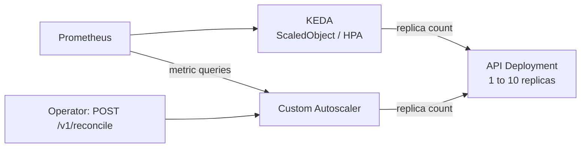

# PHASE 3 - Intelligent Autoscaling

## Overview

Phase 3 provides two scaling paths for the API: continuous KEDA/HPA scaling
from Prometheus triggers, and a custom Autoscaler API for manual scaling and
on-demand reconciliation. The current inference service is mocked, and queue,
KV cache, and throughput signals are simulated. The [README](../README.md)
describes the current limitations and the planned real inference validation.

## Architecture



The custom Autoscaler does not submit decisions to KEDA. Both paths patch the
same Deployment, so operators must define which controller owns the replica
count for each experiment. There is no periodic reconciliation loop in the
custom service: every `/v1/reconcile` call executes one decision. Its cooldown
timestamps are stored in service objects created per request and are not a
shared or durable control mechanism.

## Components

| Component | Current role |
|-----------|--------------|
| KEDA | Polls Prometheus triggers and manages the generated HPA |
| ScaledObject | Targets `jc-kubescale-api`, with 1–10 replicas and 15-second polling |
| HPA | Applies scaling policies and replica decisions for KEDA |
| Custom Autoscaler | Queries metrics and offers direct manual/on-demand scale operations |

## Scaling Metrics

| Signal | KEDA query | Trigger threshold |
|--------|------------|-------------------|
| Queue depth | `sum(queue_depth)` | 5 |
| KV cache utilization | `avg(kv_cache_utilization)` | 80% |
| p95 latency | `max(histogram_quantile(0.95, sum(rate(http_request_latency_seconds_bucket[5m])) by (le)))` | 2 seconds |

The ScaledObject configures a 60-second cooldown, a 30-second scale-up
stabilization window, and a 300-second scale-down stabilization window.
See [scaledobject.yaml](../deploy/autoscaling/scaledobject.yaml) for the full
policies and activation thresholds.

The custom service scales up by one when any high threshold is exceeded.
It scales down by one when queue depth ≤ 1, KV cache < 30%, and p95 latency
< 0.5 seconds, subject to its settings and instance-local cooldown checks.
Its Prometheus queries differ from KEDA's, so the results may differ. Token
throughput and active requests are read for reporting, but do not determine
the current scaling decision. Query failures return fallback values; verify
Prometheus health before interpreting a decision.

## API Endpoints

| Endpoint | Description |
|----------|-------------|
| `GET /health` | Process health response |
| `GET /ready` | Static readiness response |
| `GET /metrics` | Prometheus exposition; declared scale/event gauges are not updated by operations |
| `GET /v1/metrics` | Query current scaling signals |
| `GET /v1/replicas` | Read the target replica count |
| `POST /v1/reconcile` | Execute one reconciliation |
| `POST /v1/scale?replicas=N` | Request a scale bounded by configured minimum/maximum |

A successful HTTP status alone does not prove a scaling change succeeded;
inspect the `success` field and the target Deployment. Returned requested
replica counts may differ from the bounds enforced by the service.

## Deployment and Access

The API and Prometheus must already be deployed. The Make target installs
KEDA through Helm, builds/loads the Autoscaler image, and applies the selected
workload and ScaledObject manifests.

```bash
make deploy-autoscaling
make status-autoscaling
make logs-autoscaler
```

`deploy/autoscaling/keda-install.yaml` contains installation comments only;
applying it does not install KEDA. The autoscaler Deployment file also contains
the Service, duplicating the standalone `autoscaler-service.yaml`. The current
Make target selects the Deployment file rather than applying both copies.

To access the custom API, run this in a separate terminal:

```bash
kubectl --context kind-jc-kubescale port-forward -n jc-kubescale svc/jc-kubescale-autoscaler 8082:8080
```

Then inspect metrics or request one reconciliation:

```bash
curl --fail-with-body http://localhost:8082/v1/metrics
curl --fail-with-body http://localhost:8082/v1/replicas
curl --fail-with-body -X POST http://localhost:8082/v1/reconcile
```

## Load Exercise

```bash
# Run against the mock API to exercise HTTP instrumentation.
for i in {1..100}; do
  curl --fail-with-body -sS http://localhost:8080/v1/chat \
    -H 'Content-Type: application/json' \
    -d '{"message":"Autoscaling exercise"}' > /dev/null &
done
wait

kubectl --context kind-jc-kubescale get hpa -n jc-kubescale -w
```

A short burst against a fast mock may finish between scrape/polling intervals.
Observed replica growth does not establish real model throughput or GPU
capacity; KV cache utilization currently increases synthetically after HTTP
requests. Phase 6 will add a real inference adapter and reproducible k6 tests.

## Troubleshooting

| Problem | Investigation |
|---------|---------------|
| ScaledObject `READY=False` | Inspect KEDA operator logs, CRDs, target Deployment, and Prometheus connectivity |
| HPA `<unknown>` | Check the configured queries and external metrics availability |
| Query returns multiple series | Compare custom-service queries with the aggregate queries in the ScaledObject |
| Unexpected replica changes | Check KEDA/HPA and direct custom scale requests; avoid competing owners |
| Autoscaler CrashLoopBackOff | Inspect logs, imports, Kubernetes credentials, and image freshness |
| No apparent custom reconciliation | Call `/v1/reconcile`; no background loop is scheduled |

## RBAC and Cleanup

The custom Autoscaler has its own ServiceAccount, Role, and RoleBinding in
`deploy/autoscaling/autoscaler-rbac.yaml`. Its API does not enforce caller
authentication. Keep it scoped to the local development environment.

```bash
# Removes selected workload/ScaledObject resources; does not uninstall KEDA.
make undeploy-autoscaling
```

## Planned Improvements

- Phase 5: define GitOps ownership for KEDA installation and application
  workloads, remove duplicate manifests, and preserve runtime replica changes
  when Argo CD synchronizes the API.
- Phase 6: replace simulated signals with engine/request telemetry and use
  repeatable k6 load profiles. API replicas and shared backend capacity must
  be measured separately.
- Add coordinated control ownership, durable cooldowns, explicit metric-error
  handling, and failure/scaling tests.

See the [next-phase plans](../README.md#next-phases) for scope and acceptance.
