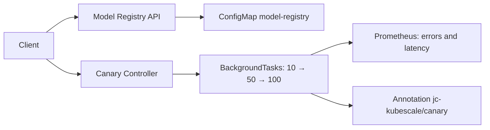

# PHASE 4 - Model Registry and Canary Deployments

## Architecture



## Model Registry

Schemas are defined in `services/api/src/app/models/registry.py`. The service
stores models and versions in memory and supports registration, retrieval,
status updates, and deletion. The registry is loaded from the `model-registry`
ConfigMap in the `jc-kubescale` namespace during initialization and saved after
each API mutation. Its name and namespace are configurable through
`MODEL_REGISTRY_CONFIGMAP` and `MODEL_REGISTRY_NAMESPACE`. Both the base and
Helm Deployments use the pod's namespace.

The ConfigMap is created automatically when missing. A persisted empty registry
is preserved without recreating deleted models on the next restart. The
in-memory cache remains local to each process; caches are not automatically
synchronized across replicas, and writes across replicas are not coordinated.

The API requires in-cluster Kubernetes configuration or a valid local kubeconfig.
The base Deployment uses the `jc-kubescale-api` ServiceAccount, with ConfigMap
permissions defined in `deploy/base/api-rbac.yaml`. The Makefile's `deploy`
target applies this RBAC before the Deployment.

The Helm chart also creates its ServiceAccount and, when
`security.rbacEnabled: true`, a Role and RoleBinding. If disabled, RBAC must be
provided externally. The chart's RBAC authorizes the default name
`model-registry`; customizing the name requires updating the corresponding
permissions.

Registry routes run the synchronous Kubernetes client in FastAPI's thread pool,
with explicit request timeouts. The service persists changes before publishing
them to the cache. Failed writes do not publish the new local state. A lock
serializes mutations within each process.

Configuration, authorization, connectivity, and invalid persisted data errors
return HTTP 503 with `code` and `detail` instead of a generic HTTP 500. Write
conflicts return HTTP 409. Logs include the namespace, ConfigMap, error code,
and status returned by Kubernetes. An initially missing ConfigMap (404) is
expected and triggers creation; it does not prove an RBAC failure.

The router in `services/api/src/app/api/model_registry.py` provides:

- `GET /v1/models`
- `POST /v1/models`
- `GET /v1/models/{name}`
- `GET /v1/models/{name}/versions/{version}`
- `PATCH /v1/models/{name}/versions/{version}/status`
- `DELETE /v1/models/{name}/versions/{version}`

The ConfigMaps in `deploy/models/` describe Qwen v1 and v2. The service
initializes demonstration models; it does not load these ConfigMaps automatically.

## Canary Controller

The service is located in `services/canary/`, with a Dockerfile, dependencies,
JSON logging, and health and metrics endpoints.

- `GET /v1/canary`: retrieves the percentage from the Deployment annotation.
- `POST /v1/canary/{percentage}`: sets the percentage between 0 and 100.
- `POST /v1/rollout`: schedules the stages and returns `status: started` and
  `stages`; the background task queries Prometheus during the rollout.
- `POST /v1/rollback`: resets the percentage to zero.
- `GET /health`, `GET /ready`, and `GET /metrics`.

Settings include `TARGET_NAMESPACE`, `TARGET_DEPLOYMENT`, `CANARY_STAGES`,
`CANARY_INTERVAL`, `CANARY_ERROR_THRESHOLD`, `CANARY_LATENCY_THRESHOLD`,
`PROMETHEUS_URL`, and `LOG_LEVEL`.

The manifests in `deploy/canary/` include a Deployment and Service in the same
file, plus a ServiceAccount, Role, and RoleBinding in the RBAC file. The
Deployment receives its configuration through environment variables.

### Build, Update, and Access

```bash
# load-canary already depends on build-canary; this single target is sufficient.
make load-canary
kubectl --context kind-jc-kubescale rollout restart deployment/jc-kubescale-canary -n jc-kubescale
kubectl --context kind-jc-kubescale rollout status deployment/jc-kubescale-canary -n jc-kubescale --timeout=120s
kubectl --context kind-jc-kubescale port-forward -n jc-kubescale svc/jc-kubescale-canary 8081:8080
```

In another terminal:

```bash
curl --fail-with-body http://localhost:8081/health
curl --fail-with-body http://localhost:8081/v1/canary
curl --fail-with-body -X POST http://localhost:8081/v1/canary/25
curl --fail-with-body -X POST http://localhost:8081/v1/rollback
curl --fail-with-body -X POST http://localhost:8081/v1/rollout
```

Expected response when starting a rollout:

```json
{"status":"started","message":"Rollout started in background","stages":[10,50,100]}
```

The `started` status confirms scheduling, not completion. Follow the logs until
`Rollout completed successfully` or a failure/rollback message appears:

```bash
kubectl --context kind-jc-kubescale logs -n jc-kubescale -l app=jc-kubescale-canary --tail=50 -f
kubectl --context kind-jc-kubescale get deployment jc-kubescale-api -n jc-kubescale -o go-template='{{index .metadata.annotations "jc-kubescale/canary"}}{{"\n"}}'
```

With a 30-second interval, the three stages require at least 90 seconds, plus
Kubernetes and Prometheus query time. Wait for completion before the final
rollback; a task that is still running can advance the annotation again.

```bash
curl --fail-with-body -X POST http://localhost:8081/v1/rollback
curl --fail-with-body http://localhost:8081/v1/canary
```

### Registry Examples

```bash
curl --fail-with-body http://localhost:8080/v1/models
curl --fail-with-body -X POST http://localhost:8080/v1/models \
  -H 'Content-Type: application/json' \
  -d '{"name":"qwen-test-final","version":"1","status":"ready"}'
curl --fail-with-body -X PATCH http://localhost:8080/v1/models/qwen-test-final/versions/1/status \
  -H 'Content-Type: application/json' -d '{"status":"deprecated"}'
```

### Troubleshooting

A connection closed during a rollout can result from a blocked event loop,
a pod restart, a failed port-forward, or an intermediary timeout. The symptom
alone does not establish a fixed 60-second Uvicorn timeout. Use
`BackgroundTasks` to respond before the waits, and confirm that the new image
has been loaded into Kind and the Deployment restarted. If the port-forward
terminates when its pod is replaced, restart only the corresponding process.

For Registry permission failures, check every pod's ServiceAccount, RBAC, and
the Deployment's pod template. Applying a template change starts a rollout;
manually deleting all pods is unnecessary.

```bash
kubectl --context kind-jc-kubescale get pods -n jc-kubescale -l app=jc-kubescale-api -o custom-columns=NAME:.metadata.name,SA:.spec.serviceAccountName
kubectl --context kind-jc-kubescale auth can-i create configmaps --as=system:serviceaccount:jc-kubescale:jc-kubescale-api -n jc-kubescale
kubectl --context kind-jc-kubescale get configmap model-registry -n jc-kubescale
```

## Implementation Limitations

The controller only changes the Deployment's `jc-kubescale/canary` annotation.
Actual traffic splitting between versions requires a router that consumes this
annotation. Rollback only resets the annotation to zero; it does not restore
images or ReplicaSets.

Prometheus queries aggregate available metrics without distinguishing the canary
version. Query failures and missing data return zero in the implementation,
potentially allowing progression without effective validation. The rollout
performs synchronous waits in a `BackgroundTasks` task, outside the event loop,
and does not coordinate concurrent requests. The task lives in the service
process and does not automatically resume after restarts. The canary metrics
declared in the entrypoint are not yet updated by the service.

## Integration

The Registry router is included in `services/api/src/main.py`. The previous
listing endpoint in `app/api/routes.py` was removed so that `GET /v1/models`
is handled by the Registry without duplicate routes.

The `Makefile` includes the `build-canary`, `load-canary`, `deploy-canary`,
`status-canary`, `logs-canary`, and `undeploy-canary` targets.

The subsequent diagnostic request authorized the cluster correction and Registry
HTTP tests. The Deployment's ServiceAccount was corrected, its rollout completed
with two ready replicas, and listing, registration, updates, and persistence were
confirmed. The [README validation summary](../README.md#validation-and-ci)
records the scope and limitations. The API image was not rebuilt during that
correction.

## Rollout Validation on October 17, 2026

The Canary image was rebuilt with `make build-canary`, loaded into all Kind
nodes, and activated with `rollout restart`. The Canary Deployment rollout
completed; the new pod became ready and had no restarts during the test. The
port-forward to the old pod lost its connection after replacement; a new
port-forward was opened on `localhost:8081`.

The local endpoint already used `BackgroundTasks`; the correction added `stages`
to the response and changed routes using synchronous Kubernetes calls into
`def` functions, executed by FastAPI in its thread pool. Progressive work
continues in the background without waiting for its intervals before returning
the HTTP response.

| Check | Observed Result |
|-------|-----------------|
| `/health` on port 8081 | HTTP 200 before and during the rollout |
| Registry: listing, registration, and status update | HTTP 200 |
| `qwen-test-final:1` in the ConfigMap | Persisted with status `deprecated` |
| Set 25% | Success; annotation confirmed at 25 |
| Rollback before the rollout | Success; percentage 0 |
| `POST /v1/rollout` | HTTP 200 in approximately 19 ms; `started` and `[10,50,100]` |
| Progression | 10%, 50%, and 100%, confirmed in samples and logs |
| Completion | `Rollout completed successfully` after 90 seconds |
| Final rollback | HTTP 200; percentage 0 confirmed in the API and Deployment |

Log timestamps converted to America/Belem:

| Event | Time |
|-------|------|
| Start / 10% | 00:49:16 |
| Health check / 50% | 00:49:46 |
| Health check / 100% | 00:50:16 |
| Final check / completion | 00:50:46 |

All three queries recorded an error rate of 0 and a p95 latency of approximately
5–6 ms. Manual rollback was validated; no failure was injected to exercise
automatic rollback. Validation confirms annotation progression, without
establishing actual traffic splitting between versions.

The HTTP monitor had to reopen an idle connection that expired between samples;
the original rollout continued without restarting. Subsequent queries used a
new connection for each sample. Python syntax for all 11 Canary files and
whitespace in the changes were also checked.

## Next Phases

Phase 5 will introduce Argo CD GitOps on Kind; Phase 6 will connect and measure
an inference workload. Both remain planned in the [README](../README.md#next-phases).
Argo CD must preserve the runtime replica count, Canary annotation, and
API-created Registry data when resource ownership moves from manual deployment.
Real inference alone does not implement weighted model traffic routing.
